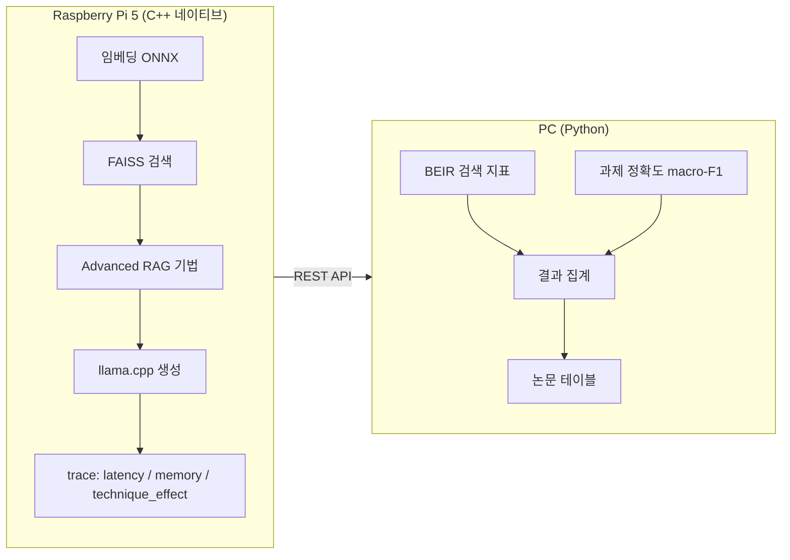

# 연구 계획서 (v2, 2026-08-04)

> v1 대비 변경 요약: 가설에 인과 기제 추가, RAGAS 중심 지표를 과제 정확도 중심으로
> 교체, 구현 충실도·기법 실행률·기준선이라는 세 가지 타당성 방어 장치 신설,
> 데이터셋에서 NQ 제외, 예비 실험 실측치 반영, 일정 재산정.
> 모든 수치는 Raspberry Pi 5에서 실측한 값이며 출처를 함께 적었다.

---

## 1. 연구 배경 및 공백

Advanced RAG 기법은 대부분 7B 이상, 실질적으로는 GPT-3.5/4급 생성기를 전제로
제안되고 검증되었다. 소형 언어 모델(SLM, ~1B 이하) 환경에서 이 기법들이 그대로
작동하는지는 체계적으로 검증된 바 없다.

MiniRAG(arXiv:2501.06713)는 SLM에서 기존 RAG 아키텍처가 심각한 성능 저하를
보임을 실증했고, Pleias-RAG-350M(arXiv:2504.18225)은 RAG 특화 학습으로 350M
모델이 4B를 넘길 수 있음을 보였다. 두 연구 모두 **"SLM+RAG 문제를 어떻게
해결할까"**에 집중한다.

**본 연구의 공백은 다르다.** 기존에 제안된 Advanced RAG 기법들 중 **무엇이
SLM 환경에서 살아남는가**를 기법별 ablation으로 측정한 연구가 없다. 실무자는
"HyDE를 켤 것인가"를 결정해야 하는데, 그 답을 줄 근거가 없다.

---

## 2. 연구 가설과 인과 기제

### 2.1 가설

> 소형 언어 모델(~1B 이하) 기반 RAG에서, **생성 모델을 호출해 구현되는** Advanced
> RAG 기법(HyDE, Query Rewriting, Contextual Compression)은 효과가 제한적이거나
> 역효과를 보인다. 반면 **생성 모델과 무관한** 기법(Re-ranking, Sentence Window)은
> 유의미한 향상을 가져올 수 있다.

### 2.2 왜 그런가 — 순환 의존

v1 계획서는 "생성 모델 의존도"를 기법 분류의 축으로 삼았으나 그 이유를 적지
않았다. 기제는 다음과 같다.

다섯 기법 중 셋은 **별도 알고리즘이 아니라 같은 생성기에 다른 프롬프트를 주는
것**이다. 코드상 개입 지점이 이를 드러낸다.

| 기법 | 구현 방식 | 생성기 호출 |
|---|---|---|
| Query Rewriting | 생성기에게 질의 재작성을 시킴 | 1회 |
| HyDE | 생성기에게 가상 문서 생성을 시킴 | N회 (원문 8) |
| Contextual Compression | 생성기에게 문서 발췌를 시킴 | top_k회 |
| Re-ranking | 별도 크로스인코더(BGE) | 0회 |
| Sentence Window | 규칙 기반 문장 확장 | 0회 |

따라서 **약한 생성기를 돕기 위한 기법의 품질이, 바로 그 약한 생성기에 묶여
있다.** 이 순환이 가설의 인과 기제이며, 본 연구가 측정하려는 대상이다.

### 2.3 예비 실험이 이미 시사하는 것

Gemma 3-270M, SciFact 300문항 기준(§9 상세):

- Query Rewriting이 **300건 중 252건(84%)에서 원본과 동일한 질의를 반환**했다.
  기법이 "효과가 없었던" 것이 아니라 **실행되지 않았다.**
- 실제로 재작성된 경우에도 문법 교정·대문자화 수준이었고, 짝지어 비교한 MRR
  순효과는 **−0.024**(개선 2건 / 악화 2건 / 무변화 10건)였다.

---

## 3. 연구 질문

- **RQ1.** 생성기 비의존 기법(Re-ranking, Sentence Window)은 SLM RAG에서
  검색 품질과 답변 정확도를 개선하는가?
- **RQ2.** 생성기 의존 기법(HyDE, Query Rewriting, Contextual Compression)은
  SLM RAG에서 개선을 가져오는가, 아니면 **실행 자체가 실패**하는가?
- **RQ3.** 각 기법의 개선폭 대비 온디바이스 비용(레이턴시, 메모리, 토큰)은
  어느 수준인가?
- **RQ4.** (도메인 일반화) 위 결론은 도메인이 바뀌어도 유지되는가?

RQ2를 "효과가 있는가"가 아니라 **"실행되는가 / 효과가 있는가"의 2단계**로
나눈 것이 v1과의 핵심 차이다. 두 실패는 원인이 다르고 실무 함의도 다르다.

---

## 4. 방법론적 기여

본 연구가 결과와 별개로 제시하는 방법론은 셋이다. **음성 결과를 주장하려면
"우리가 잘못했다"는 반박을 먼저 차단해야 하며, 셋은 그 장치다.**

### 4.1 기법 실행률 계측 (technique effect)

기존 구현들은 변환 실패를 예외 처리 여부로만 센다. 그러면 **모델이 입력을 그대로
돌려준 경우(no-op)가 성공으로 집계된다.** 본 연구는 상태를 넷으로 분리한다.

```
applied        변환이 실제로 무언가를 바꿨다
noop           변환이 입력을 그대로 돌려줬다  ← 기존 구현이 성공으로 세던 것
fallback       변환이 실패해 방어 로직이 원본을 복구했다
not_applicable 해당 모드에 변환 단계가 없다
```

no-op과 fallback은 **결과가 같지만 원인이 정반대**다. 하나는 모델이 일을 안 한
것이고 하나는 방어 로직이 작동한 것이다. 이를 구분하지 않으면 "기법이 효과
없음"과 "기법이 실행 안 됨"을 구분할 수 없다.

**작은 모델로 Advanced RAG를 평가한 기존 보고 중 상당수가 후자를 전자로
보고했을 가능성이 있다.**

### 4.2 구현 충실도 감사 (implementation fidelity)

각 기법을 원 논문·공식 구현과 항목별로 대조하고, 차이를 문서화한다
(`docs/implementation_fidelity.md`). 본 연구 착수 시점의 자체 감사에서 다음이
발견되어 수정되었다.

| 기법 | 원문 사양 | 감사 전 구현 |
|---|---|---|
| HyDE | 가상 문서 N=8 + 원본 질의의 임베딩 평균 | 문서 1개로 질의를 **대체** |
| Contextual Compression | 문서별 호출, 원문 발췌(`*AS IS*`) | 일괄 호출, 요약 |
| Sentence Window | 문장 단위 색인 → 검색 후 윈도우 치환 | 청크 색인, 사후 문장 절단 |
| Query Rewriting | few-shot, `;` 구분 복수 질의 | zero-shot, 단일 질의 |
| Re-ranking | 크로스인코더 표준 | 구조 일치 (ONNX 입력 폴백만 결함) |

HyDE의 경우 **원본 질의 임베딩을 평균에 포함하는 것이 알고리즘의 핵심**인데
(생성이 빗나가도 검색 벡터가 질문 근처를 유지하는 앵커 역할), 그것이 빠져 있으면
"HyDE가 효과 없다"는 결론은 성립하지 않는다.

### 4.3 효과 크기의 분모 — closed-book / oracle 기준선

모든 기법은 생성기가 보는 컨텍스트를 개선하려는 시도다. 개선 가능한 폭을 모르면
결과를 해석할 수 없다.

| 조건 | 생성기에 주는 컨텍스트 | 의미 |
|---|---|---|
| **closed-book** | 없음 | 바닥 — 검색 없이 모델이 아는 것 |
| **retrieved** | 실제 검색 결과 | 측정 대상 |
| **oracle** | gold 근거 직접 주입 | 천장 — 검색이 완벽할 때 |

효과 크기는 원시 차이가 아니라 **`oracle − closed-book` 대비 비율**로 보고한다.

- retrieved ≈ closed-book → 모델이 컨텍스트를 쓰지 않음. 어떤 기법도 무의미
- retrieved ≈ oracle → 검색이 이미 천장. 개선 여지가 없음
- 구간이 넓을 때만 기법 비교가 의미를 가짐

### 4.4 양성 대조

음성 결과의 필수 방어 장치다. 두 가지를 둔다.

1. **파이프라인이 효과를 검출할 수 있음** — Re-ranking이 개선을 보이는지.
   생성기와 무관하므로 SLM의 한계와 분리해 측정된다.
2. **기법 자체는 유효함** — 동일 기법을 대형 API 모델로 한 번 돌려 no-op이
   사라지고 검색이 개선되는지. 이것이 있어야 **"기법의 문제가 아니라 생성기
   크기의 문제"**라는 인과가 확정된다.

---

## 5. 시스템 및 기술 스택

| 구성 | 선택 | 실측 제약 |
|---|---|---|
| 하드웨어 | Raspberry Pi 5 8GB | 4× Cortex-A76 2.4GHz, 가용 RAM 7.4GB, 디스크 120MB/s |
| 추론 엔진 | llama.cpp (C++ 네이티브) | ARM dotprod 지원, i8mm 미지원 |
| 생성 모델 | **미정** (§10.1) | 후보 4종 모두 근거 민감도 대조 실패 |
| 임베딩 | all-MiniLM-L6-v2 (ONNX, 90MB, 384dim) | **최대 256토큰** — §6.2 참조 |
| 리랭커 | bge-reranker-base (ONNX, 826MB) | 크로스인코더 |
| 벡터 검색 | FAISS `IndexFlatIP` (C++) | 무압축 fp32, 전수 탐색 |
| 평가 | PC (Python) + REST | BEIR 지표 + 과제 정확도 |

### 5.1 아키텍처



---

## 6. 실험 설계

### 6.1 독립 변수

| 기법 | 분류 | 생성기 호출 | 구현 상태 | 가설 |
|---|---|---|---|---|
| Naive RAG | 베이스라인 | 0 | 완료 | — |
| Re-ranking (bge) | 검색 | 0 | **완료** | 효과 있음 |
| Sentence Window | 검색 | 0 | **문장 색인 미구현** | 효과 있음 |
| Contextual Compression | 컨텍스트 | top_k | **완료(원문화)** | 부분적 |
| HyDE | 검색 | N=8 | **완료(원문화)** | 없음/역효과 |
| Query Rewriting | 검색 | 1 | 복수 질의 미구현 | 없음/역효과 |

**Hybrid Search(BM25 + Dense)는 범위에서 제외한다.** 가설상으로는 생성기
비의존 기법이라 검증 가치가 있으나, 두 가지 이유로 뺐다.

첫째, C++ 네이티브 구현 비용이 다른 기법과 급이 다르다. 역색인, 문서 길이 정규화,
용어 통계 관리를 직접 만들어야 하고, 파이썬 생태계처럼 검증된 라이브러리를 가져다
쓸 수 없다.

둘째, **자유 파라미터가 급증한다.** BM25의 `k1`·`b`, 융합 방식(RRF / 가중합 /
CombSUM), 융합 가중치, sparse·dense 각각의 후보 수까지 정해야 한다. 본 연구는
기법 간 비교가 목적인데, 한 기법만 튜닝 공간이 넓으면 **그 기법의 성능이 기법
자체가 아니라 튜닝 노력을 반영하게 된다.** 통제된 ablation의 전제가 무너진다.

논문에는 이 제외를 한계로 명시한다. "검색 단계 최적화 기법 중 파라미터 없이
적용 가능한 것(Re-ranking)만 다뤘다"는 서술이 정확하다.

### 6.2 통제 변수 — 선택한 것과 강제된 것

v1은 이를 구분하지 않았으나, **강제된 값은 그 자체가 온디바이스 제약의
관찰 결과**이므로 구분이 필요하다.

| 변수 | 값 | 성격 |
|---|---|---|
| 청킹 | 256토큰 / overlap 32 | **강제** — MiniLM의 최대 시퀀스 길이가 256 |
| Top-k | 3 | 선택 (§10.3에서 재검토) |
| 프롬프트 템플릿 | 데이터셋별 고정 | 선택 |
| seed / temperature | 42 / 0.1 | 선택 (HyDE는 예외, §6.3) |

**청킹이 강제라는 점은 논문에 실을 만한 관찰이다.** SciFact 초록은 평균 279토큰,
p95 463토큰이라 512토큰 임베딩 모델(BGE-small 등)에서는 청킹이 불필요하다.
실제로 BEIR 공식 평가는 SciFact를 청킹하지 않는다. 그런데 온디바이스 제약으로
256토큰 모델을 쓰면 **초록의 54%가 쪼개지고**, 문서 단위 채점을 위해 MaxP 집계가
강제된다. 데스크톱 환경에서는 발생하지 않는 문제다.

### 6.3 HyDE의 샘플링 예외

HyDE 원문은 temperature 0.7로 8개를 뽑아 평균한다. 본 연구의 고정 seed·저온
설정에서는 8개 생성이 전부 동일해져 **평균이 N=1로 붕괴**한다. 따라서 HyDE
생성만 원문 파라미터(temp 0.7, max_tokens 512)를 쓰고, draw마다
`config.seed + draw`로 seed를 오프셋한다. **run 전체의 재현성은 유지되면서 한
질의 안의 draw만 달라진다.** 실측으로 8개 문서가 전부 상이하고, 동일 요청 2회의
문서 해시와 검색 결과가 일치한다.

### 6.4 종속 변수

v1은 RAGAS 4지표를 주 지표로 삼았다. **실측 결과 그 설계는 유지할 수 없다.**

**주 지표 — 검색**

| 지표 | 정의 | 왜 이것인가 |
|---|---|---|
| **컨텍스트 적중률@k** | gold 근거가 프롬프트에 들어간 질의 비율 | 인과 사슬의 병목. 들어가지 않으면 생성기가 맞출 방법이 없다 |
| **precision@k** | 컨텍스트 중 유관 비율 | 온디바이스에서 컨텍스트 토큰은 직접 비용 |

**nDCG를 주 지표에서 제외한다.** nDCG의 위치 할인은 사용자가 순위 목록을 위에서
아래로 훑는 상황을 모델링하는데, LLM 프롬프트에 나란히 붙는 문단 3개에는
해당하지 않는다. 또한 본 파이프라인은 top_k=3만 검색하므로 recall@3 = recall@10이
되어 **k>3 지표가 구조적으로 무의미하다**(§9.3). nDCG는 표준 깊이 검색을 별도로
돌려 **타 연구와의 위치 확인용**으로만 보고한다.

**주 지표 — 과제 정확도**

| 데이터셋 | 지표 |
|---|---|
| SciFact | 라벨 macro-F1 (SUPPORT / CONTRADICT / NOINFO) |
| FiQA | 검색 지표만 (짧은 정답 부재, §7) |

**주 지표 — 실행률**

기법별 `applied / noop / fallback` 비율. §4.1.

**보조 지표 — 효율**

토큰/초, VmHWM 메모리(MB), 단계별 레이턴시(model_load / retrieval / rerank /
context_transform / generation), 보조 생성 토큰 수.

**RAGAS의 위치 재조정.** `context_precision`과 `context_recall`은 BEIR 지표와
소수점 둘째 자리까지 사실상 같은 값을 내면서(§9.4) LLM 심판 비용을 요구한다.
주 실험에서 제외한다. `faithfulness`와 `answer_relevancy`는 생성기가 컨텍스트에
반응하기 시작한 뒤 **부분표본으로만** 부차 보고한다.

---

## 7. 데이터셋

| 데이터셋 | 코퍼스 | test 질의 | 도메인 | 역할 |
|---|---|---|---|---|
| **SciFact** | 5,183 | 300 | 생의학 초록, 격식체 | 주 데이터셋 |
| **FiQA-2018** | 57,638 | 648 | 금융 포럼, 비격식체 | 도메인 일반화 |

**Natural Questions는 제외한다.** 이유는 셋이다.

1. **짧은 정답 문자열이 없다.** BEIR 변환본의 500개 질의 전부 `metadata`가 비어
   있어 EM/F1을 계산할 수단이 없다. 데이터 자체의 결손이다.
2. **코퍼스가 원본의 0.77%다.** 전체 2,681,468 passage 중 20,623개만 쓴다.
   전체를 쓰면 인덱스 4.17GB + 청크스토어 1.69GB로 Pi 가용 RAM(7.4GB)에서
   모델까지 올릴 수 없다. 부분표본 상태의 검색 수치는 공개된 BEIR NQ 값과 비교할
   수 없다.
3. 방해 문서 선별이 코퍼스 파일 앞쪽 2만 줄을 순서대로 취하는 방식이라 질의와의
   근접성이 통제되지 않는다.

**FiQA로 대체하는 근거.** 도메인이 실제로 멀다(생의학 격식 문어체 ↔ 금융 포럼
구어체). 57,638문서 전체를 부분표본 없이 쓸 수 있어 검색 수치가 공개 값과 비교
가능하다. 공개 nDCG@10이 BM25 0.236 / ColBERT 0.317 수준으로 SciFact(0.6대)보다
어려워 **기법이 효과를 낼 여지가 넓다.**

FiQA도 짧은 정답이 없어 과제 정확도는 못 잰다. 이는 BEIR 전체의 성격이며,
데이터셋 교체로 해결되지 않는다.

---

## 8. 실험 절차

```
Phase 0  구현 충실도 감사 및 수정          (§4.2)
         ↓ 각 기법이 원문대로 구현되었음을 확인
Phase 1  실행률 계측 (technique_effect)     (§4.1)
         ↓ 기법이 실제로 실행되는지 확인. 실행률이 낮으면 원인 규명 후 재수행
Phase 2  기준선 측정 (closed-book / oracle) (§4.3)
         ↓ 측정 가능한 폭이 0이면 생성 실험을 중단하고 생성기 문제로 회귀
Phase 3  양성 대조                          (§4.4)
         ↓ 파이프라인이 효과를 검출할 수 있음을 확인
Phase 4  본 실험 (SciFact 6모드)
Phase 5  도메인 일반화 (FiQA 6모드)
Phase 6  분석 및 작성
```

**Phase 2가 게이트다.** 구간이 0이면 Phase 4 이후는 어떤 수치가 나와도 해석되지
않는다. v1 계획에는 이 게이트가 없었고, 실제로 첫 실행에서 14시간을 쓴 뒤에야
문제를 발견했다.

---

## 9. 예비 실험 결과 (실측)

모두 Raspberry Pi 5에서 측정했다.

### 9.1 생성 모델 후보

| | gemma-3-270m | SmolLM2-360M | Qwen3-0.6B | Qwen3-1.7B |
|---|---|---|---|---|
| GGUF 파라미터 | 268.10M | 361.82M | 751.63M | 1.72B |
| 어휘 | 262,144 | 49,152 | 151,936 | 151,936 |
| 임베딩 비중 | **62.6%** | 13.0% | 41.4% | — |
| **트랜스포머 본체** | **100.3M** | **314.6M** | **440.4M** | — |
| llama-bench pp512 | 616 t/s | 128 t/s | 91.9 t/s | 52.4 t/s |
| llama-bench tg128 | 38.5 t/s | 16.0 t/s | 9.09 t/s | 10.1 t/s |
| 서빙 generation p50 | 3,777 ms | 6,926 ms | 10,915 ms | 18,188 ms |

**파라미터 총량은 오해를 부른다.** Gemma 3-270M은 3분의 2가 262k 어휘의 임베딩
테이블이고, 실제로 계산하는 파라미터는 약 100M뿐이다. SmolLM2-360M은 어휘가
49k라 명목상 비슷한 크기에서 3.1배 큰 본체를 갖는다.

### 9.2 근거 민감도 대조 (Gemma 3-270M)

- **라벨 순서 뒤집기**: `SUPPORTS, REFUTES, NOT_ENOUGH_INFO` 순으로 제시하면
  12/12가 SUPPORTS, 순서를 뒤집으면 같은 12문항이 12/12 REFUTES. **먼저 본
  라벨을 그대로 출력한다.**
- **데이터셋 원본 부정문 쌍**: gold가 SUPPORTS인 6건과 REFUTES인 6건에 **전부
  SUPPORTS로 답했다.** ALDH1 "poorer prognosis"(SUPPORTS)와 "better
  outcomes"(REFUTES) 모두 Yes.
- 반박하는 문장이 **1순위 근거로 프롬프트에 들어간 상태에서도** 틀렸다.

**Qwen3-0.6B도 동일하게 실패한다**(12/12 SUPPORTS). Qwen3-1.7B는 부정문 쌍 0/3.

### 9.3 검색 품질과 지표의 한계 (SciFact, `none`, 300문항)

```
gold가 1위        152건 (50.7%)
gold가 2위         34건 (11.3%)
gold가 3위         19건 ( 6.3%)
top-3 안에 없음    95건 (31.7%)   ← 개선 여지
```

검색은 포화 상태가 아니며 **31.7%p의 개선 여지가 있다.** 그런데도 `none`과
`query_rewrite`의 nDCG@10이 0.5965 vs 0.599로 붙었다. 원인은 검색 난이도가
아니라 **84% no-op**이었다.

| k | precision | recall | nDCG |
|---|---|---|---|
| 1 | 0.5067 | 0.4889 | 0.5067 |
| 3 | 0.2356 | **0.6612** | 0.5979 |
| 10 | 0.0707 | **0.6612** | 0.5965 |

recall이 k=3에서 멈춘다. top_k=3만 검색하기 때문이다. **현재 보고되는 nDCG@10은
3개짜리 목록에 대한 값이며 공개 리더보드와 비교할 수 없다.**

### 9.4 RAGAS와 BEIR의 중복

| | BEIR (qrels 정확 계산) | RAGAS (LLM 심판) |
|---|---|---|
| none | ndcg@3 0.598 | context_precision 0.592 |
| none | recall@3 0.661 | context_recall 0.629 |
| query_rewrite | ndcg@3 0.600 | context_precision 0.605 |
| query_rewrite | recall@3 0.665 | context_recall 0.625 |

비용은 RAGAS가 지배한다. 300문항 1모드가 `none` 4.5시간, `query_rewrite`
5.0시간이며 거의 전부가 judging이다. **RAGAS를 제외하면 12개 run 전체가 80시간에서
10시간 이내로 줄어든다.**

### 9.5 원문 충실 구현의 비용 (HyDE)

N=8로 원문대로 구현하면 쿼리당 **57초**(생성 8회, 보조 출력 1,826토큰)다.
`none`이 쿼리당 4초 수준이므로 **14배**이며 300문항에 4.75시간이다.

**이는 숨길 값이 아니라 RQ3의 답이다.** N을 낮춘다면 낮춘 값을 명시하며, 그
자체가 "온디바이스에서는 HyDE의 원형을 감당할 수 없다"는 결과가 된다.

---

## 10. 미결 결정 사항

### 10.1 생성 모델 (최우선)

후보 4종이 모두 §9.2의 대조를 통과하지 못했다. 선택지는 셋이다.

1. **더 큰 모델** — 다만 1.7B도 실패했으므로 3B급 이상이 필요할 수 있고, 그러면
   온디바이스 전제가 흔들린다
2. **파인튜닝** — SciFact train split으로 SmolLM2-360M을 튜닝. 승산이 높으나
   주장이 "zero-shot"에서 "태스크 튜닝"으로 바뀐다
3. **범위 축소** — 생성 주장을 접고 검색 층위 결과만으로 논문 구성

§4.3의 기준선이 있으면 이 선택이 측정으로 바뀐다. **쓸 수 있는 모델이란
oracle이 closed-book과 벌어지는 모델이다.** 20~30문항 수작업 대조가 아니라
정량 기준으로 후보를 고를 수 있다.

### 10.2 임베딩 모델

MiniLM-L6의 256토큰 한계가 청킹을 강제한다(§6.2). BGE-small-en-v1.5(133MB,
384dim, **512토큰**)로 바꾸면 SciFact 청킹이 거의 사라지고 BEIR 관행과 조건이
맞는다. 리랭커와 같은 BAAI 계열이라 일관성도 생긴다.

비용: 전 인덱스 재생성, 질의 접두어 처리 추가, 토크나이저 호환성 검증.

### 10.3 Top-k

3이 최선인지 검증되지 않았다. gold가 top-3에 못 들어가는 비율이 31.7%이므로
5나 10으로 늘리면 적중률이 오르지만, 프롬프트가 길어져 레이턴시가 는다
(Qwen3-0.6B 기준 프롬프트 1,000토큰에 11초). **컨텍스트 예산 자체를 실험 변수로
둘지** 결정이 필요하다.

### 10.4 Sentence Window의 지표 비교 방식

문장 단위 색인으로 바꾸면 검색 입도가 달라져 다른 모드와 BEIR 지표를 직접 비교할
수 없다. 문서 단위 top-k를 맞출지, 컨텍스트 토큰 예산을 맞출지, 검색 평가와 생성
평가를 분리할지 정해야 한다.

---

## 11. 위험과 완화

| 위험 | 영향 | 완화 |
|---|---|---|
| 생성기가 근거를 읽지 못함 | 기법 5개 중 2개 측정 불가 | §4.3 기준선으로 조기 판정, §10.1 |
| 음성 결과가 "구현 잘못"으로 반박 | 논문 기각 | §4.2 충실도 감사 + §4.4 양성 대조 |
| 기법이 조용히 미실행 | 잘못된 결론 | §4.1 실행률 계측 |
| 원문 충실 구현의 비용 초과 | 실험 시간 폭증 | 파라미터 축소 시 명시적 보고 (§9.5) |
| Pi 절전·재부팅으로 run 중단 | 시간 손실 | `--skip-existing` 재개, 단 결과 파일 유효성 확인 필요 |

---

## 12. 일정 (재산정)

환경 구축과 C++ 파이프라인 구현은 완료되었다. 남은 작업 기준이다.

| 단계 | 내용 | 기간 |
|---|---|---|
| A | 구현 충실도 수정 완료 (Sentence Window, Query Rewriting) | 1~2주 |
| B | 과제 정확도 지표 구축 (SciFact macro-F1) | 1주 |
| C | 기준선 배선 (closed-book / oracle, 평가기 측) | 1주 |
| D | 생성 모델 결정 (§10.1) | 2~3주 |
| E | 양성 대조 + 예비 측정 | 1~2주 |
| F | 본 실험 (SciFact) | 1주 |
| G | 도메인 일반화 (FiQA) | 1~2주 |
| H | 분석 및 작성 | 3~4주 |
| **합계** | | **약 3~4개월** |

D의 폭이 넓은 것은 §10.1의 세 선택지 중 무엇을 택하느냐에 따라 달라지기
때문이다. 파인튜닝을 택하면 +2주, 범위 축소를 택하면 −2주다.

---

## 13. 기대 기여

1. **SLM 환경에서 Advanced RAG 기법별 효과의 최초 체계적 ablation.** 특히
   "생성기 의존 기법의 순환 의존"이라는 기제를 정량 근거와 함께 제시한다.
2. **기법 실행률 계측 방법론.** no-op을 성공과 분리하는 계측은 작은 모델을 쓰는
   모든 RAG 평가에 적용 가능하며, 기존 보고의 재해석을 요구할 수 있다.
3. **구현 충실도 감사 절차.** ablation 연구가 원 논문 대비 무엇을 다르게
   구현했는지 항목별로 공개하는 형식.
4. **C++ 네이티브 경량 RAG 파이프라인 오픈소스.** llama.cpp + ONNX Runtime +
   FAISS 조합의 Raspberry Pi 참조 구현.
5. **온디바이스 제약이 만드는 부수 효과의 문서화.** 임베딩 모델의 짧은 시퀀스
   길이가 데스크톱에서는 불필요한 청킹을 강제하고, 그것이 다시 문서 단위 채점
   방식을 강제하는 연쇄.

---

## 14. 결과물

- GitHub 저장소 (C++ RAG 파이프라인, 평가 하네스, 충실도 감사 문서)
- arXiv preprint
- 투고 후보: Journal of Computer Science and Technology (JCS&T)

---

## 15. 참고 문헌

**SLM + RAG**
- MiniRAG (arXiv:2501.06713, 2025) — SLM에서 기존 RAG 아키텍처의 성능 저하 실증
- Pleias-RAG-350M (arXiv:2504.18225, 2025) — 350M 모델의 RAG 특화 학습
- DRAG (arXiv:2506.01954, 2025) — SLM RAG 지식 증류
- Small LLMs for Biomedical Claim Verification (arXiv:2606.12854) — 3B급
  QLoRA가 GPT-4o zero-shot 초과, SciFact NEI 구조적 지름길 지적

**기법 원문 (충실도 감사의 기준)**
- HyDE — Gao et al., arXiv:2212.10496 · 구현 `github.com/texttron/hyde`
- Query Rewriting — Ma et al., EMNLP 2023, arXiv:2305.14283
- Contextual Compression — LangChain `LLMChainExtractor`
- Sentence Window — LlamaIndex `SentenceWindowNodeParser` +
  `MetadataReplacementPostProcessor`
- Re-ranking — BAAI `bge-reranker-base`

**평가 기반**
- BEIR (arXiv:2104.08663, 2021) — IR 평가 표준
- SciFact — Wadden et al., 2020, *Fact or Fiction: Verifying Scientific Claims*
- FiQA-2018 — 금융 의견 QA
- MaxP 집계 — Dai & Callan; Zhang et al., ECIR 2021
- RAG Survey (arXiv:2312.10997, 2023) — Naive/Advanced/Modular 분류

**서술 양식 참고**
- Technical report on Conversational Question Answering (arXiv:1909.10772) —
  내용이 아니라 **기술 리포트의 구성 틀**을 참고한다. 배경과 방법을 짧게 두고
  구현 세부·실험 설정·결과 테이블에 지면을 쓰는 구조, 그리고 단일 시스템의
  구성 요소별 기여를 분해해 제시하는 방식이 본 연구의 ablation 서술과 맞는다.
